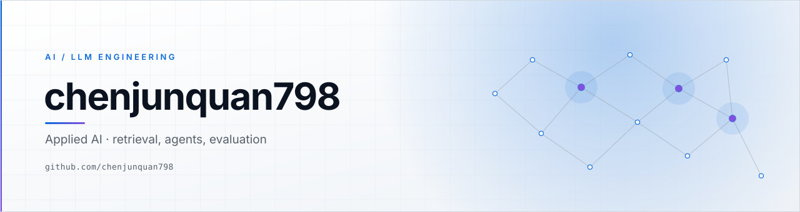
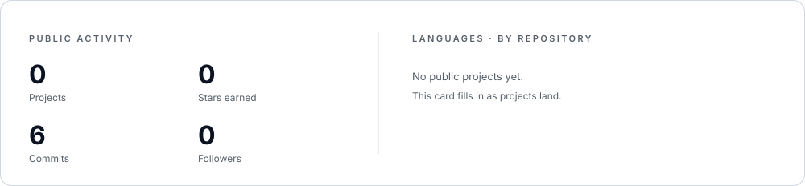

<picture>
  <source media="(prefers-color-scheme: dark)" srcset="./assets/hero-dark.svg">
  <source media="(prefers-color-scheme: light)" srcset="./assets/hero-light.svg">
  
</picture>

 

 

I build with language models — mostly the unglamorous half: grounding answers in real corpora, keeping tool-using agents on a leash, and building the evaluation that decides whether any of it ships.

我用语言模型做产品，做的多是“不性感”的那一半：让答案落回真实语料、让调用工具的智能体始终有边界，以及决定它到底能不能上线的那套评测。

---

## Now · 现在

**Currently** — turning this profile into a public lab for applied LLM work: retrieval pipelines, agent tooling, and eval harnesses that hold up outside a demo.

当前：把这个主页做成 LLM 应用的公开实验场——检索管线、智能体工具链，以及能扛住 demo 之外真实场景的评测框架。

**Open to** — collaboration on retrieval, evaluation, and developer tooling. If you are working on the same problems, open an issue or start a discussion.

乐于合作的方向：检索、评测、开发者工具。如果在做同类问题，欢迎开 issue 或 discussion。

## Focus · 关注方向

| Domain | In practice |
| :--- | :--- |
| **Retrieval & grounding** | Hybrid search, reranking, and citation-first answers over private corpora. 混合检索、重排序；基于私有语料的答案必须带出处。 |
| **Agents & tool use** | Bounded tool loops with tracing, retries, and hard cost ceilings. 有边界的工具调用循环：可追踪、可重试、成本有硬上限。 |
| **Evaluation** | Golden sets, judge models with human spot checks, regression gates in CI. 金标集、模型评审加人工抽检、CI 里的回归门禁。 |

## Stack · 技术栈

## Activity · 活跃度

<picture>
  <source media="(prefers-color-scheme: dark)" srcset="./assets/stats-dark.svg">
  <source media="(prefers-color-scheme: light)" srcset="./assets/stats-light.svg">
  
</picture>

## Contributions · 贡献

<picture>
  <source media="(prefers-color-scheme: dark)" srcset="https://raw.githubusercontent.com/chenjunquan798/chenjunquan798/output/github-snake-dark.svg">
  <source media="(prefers-color-scheme: light)" srcset="https://raw.githubusercontent.com/chenjunquan798/chenjunquan798/output/github-snake.svg">
  
</picture>

---

The banner and activity card are SVG generated in this repository — <a href="./scripts/gen_assets.py"><code>gen_assets.py</code></a> and <a href="./scripts/gen_stats.py"><code>gen_stats.py</code></a> (refreshed daily by a workflow); the snake comes from <a href="./.github/workflows/snake.yml">Actions</a>. Badges are shields.io; the rest has no third-party dependency.
